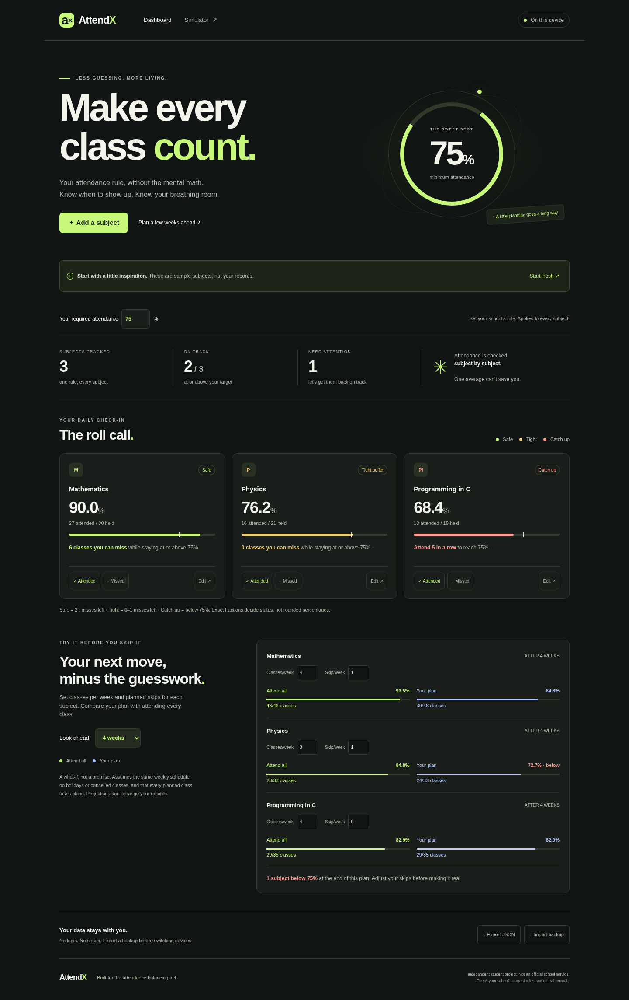
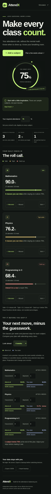

# AttendX

### Make every class count.

An attendance planner for any student, any school, and any required percentage. Find your breathing room, catch problems early, and try your next few weeks before you commit to them.

**Plain HTML, CSS and JavaScript. No framework. No build step. No account.**



## What it does

- **Your target, your rule.** Set any whole-number requirement from 1% to 100%. Starts at 75%.
- **Subject-by-subject tracking.** Add, edit or delete subjects with attended and held class counts.
- **Exact skip allowance.** See the maximum number of consecutive upcoming classes you can miss without going below your target.
- **Recovery plan.** If you're below the target, see the minimum number of consecutive classes to attend.
- **Weekly what-ifs.** Enter classes per week and planned skips per week. Compare your plan with attending everything over 1–16 weeks.
- **Quick check-in.** Mark a class attended or missed with one click. Undo the latest record change.
- **Local-first data.** Records stay in this browser's storage. Export and import JSON backups to move them between devices.
- **Dark, responsive layout.** Status labels, threshold markers, keyboard focus indicators, semantic controls and a reduced-motion preference.

The three starting subjects are fictional examples. Choose **Start fresh** to replace them with your own.

## Run it

1. Download the repository ZIP and extract it, or clone it.
2. Open `index.html` in a current desktop browser.
3. Set **Your required attendance** to your school's rule.
4. Start fresh, then add subjects using the counts from your official attendance record.
5. Mark each class, or edit a subject when your official counts change.
6. In the simulator, set the weekly class load, skips and number of weeks.
7. Export a backup before changing browsers or devices.

No terminal is needed to use the app. A static web server also works, and can make storage more predictable than `file://`. For example, with Python installed:

```sh
python3 -m http.server 8000
```

Then open `http://localhost:8000` in your browser. Keep the same host and port if you want to keep using the same stored records.

<details>
<summary>Mobile screenshot</summary>



</details>

## How the math works

Let `A` be attended classes, `T` be total classes held and `P` be the required whole-number percentage.

```text
Current attendance = 100 × A / T
At or above target = 100 × A >= P × T

Maximum upcoming misses = max(0, floor((100 × A - P × T) / P))

Consecutive classes to recover =
  max(0, ceil((P × T - 100 × A) / (100 - P)))
```

The misses calculation assumes you miss the next classes, without attending any in between. Future attendance can build more buffer. Recovery assumes you attend every next class.

For an 80% rule, the skip formula becomes `floor(A / 0.8 - T)`. The implementation uses integer cross-multiplication so floating-point rounding doesn't change a boundary decision.

| Attended / held | Target | Misses available | Classes to recover |
| --------------- | ------ | ---------------- | ------------------ |
| 8 / 10          | 80%    | 0                | 0                  |
| 9 / 10          | 80%    | 1                | 0                  |
| 15 / 15         | 80%    | 3                | 0                  |
| 14 / 19         | 80%    | 0                | 6                  |
| 13 / 19         | 75%    | 0                | 5                  |

A display rounded to `80.0%` can still be below 80%. Eligibility always uses the exact counts.

**Special cases:** `0/0` means "Not started", not 100%. With a 100% target, any existing missed class makes recovery impossible in a finite number of classes. The app says so rather than showing an invented recovery count.

For weekly classes `W`, weekly skips `S`, and weeks `N`:

```text
Projected attended = A + (W - S) × N
Projected total    = T + W × N
```

The simulator compares `S = 0` with your chosen `S`. These are end-of-period forecasts, not a guarantee that attendance stays above the target at every point along the way.

## Status labels

- **Safe:** at or above target with at least two immediate misses available.
- **Tight buffer:** at or above target with zero or one miss available.
- **Catch up:** below target.
- **Not started:** no classes have been held.

These labels are app conventions, not an institution's official eligibility ruling. There is deliberately no overall attendance average: most subject-based rules need each subject to pass on its own.

## Tests

The app has zero runtime dependencies. To run the math tests, use Node.js 18 or later:

```sh
node --test tests/math.test.js
```

Tests cover known boundaries, invalid inputs, zero classes, 100% targets, rounded displays, weekly projections, and all **515,000** combinations of integer targets 1–100 and attended/held pairs with 1–100 classes held.

The included screenshots were captured from the running app in Chrome, not design mockups. UI checks covered opening `index.html` directly, 320px/390px layouts without horizontal overflow, adding/editing/deleting subjects, undo, target changes, reload persistence, count validation, JSON export, and malformed imports.

## Project map

```text
index.html          Page structure, controls and accessible labels
style.css           Dark theme and responsive layouts
math.js             Pure calculation and validation functions
app.js              Rendering, interactions, import/export and local storage
assets/favicon.svg  Small original app icon
tests/math.test.js   Node's built-in test runner, no test libraries
docs/               Real desktop and mobile screenshots
```

## Privacy and limits

- No analytics, third-party font requests, remote scripts, or backend. Subject data is never sent by the app.
- Data is stored per browser and origin. Private browsing, clearing site data, moving files, or switching devices can remove or separate records. `file://` storage varies by browser. Keep exported backups.
- Whole-number target percentages only. One global target applies to all subjects; different per-subject rules are not supported yet.
- Up to 50 subjects, 100,000 recorded classes per subject, 30 classes per subject per week, and a 16-week projection.
- Projections assume a repeating weekly schedule. They do not know about holidays, cancellations, semester end dates, medical exemptions or separate lab/theory attendance rules.
- This is an independent planning tool, not an official school service. Always check your institution's current rules and official records.

## Next ideas

- Different targets for different subjects.
- A day-by-day timetable and holiday calendar.
- Semester-end limits and a visual week-by-week forecast.

The current version keeps the core small enough to read, understand and change.
